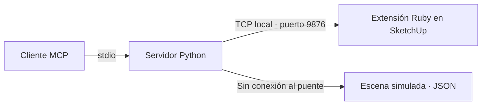

# SketchUp MCP

**Servidor MCP local para SketchUp de escritorio.** Funciona con clientes que pueden iniciar servidores MCP por `stdio`. Incluye una extensión Ruby instalable y un modo simulado para probar el flujo desde Linux.



## Primeros pasos

Necesitas Python 3.10 o posterior. Crea un entorno virtual para este proyecto. Para empezar con el modo simulado, instala solo el servidor.

```bash
python3 -m venv .venv
.venv/bin/python -m pip install -e .
```

## Configurar tu cliente MCP

Agrega un servidor local con transporte **stdio** y usa la ruta absoluta del ejecutable instalado. El cliente inicia el proceso.

| Campo | Valor |
| --- | --- |
| Nombre | `sketchup` |
| Comando en Linux y macOS | `/ruta/al/proyecto/.venv/bin/mcp-sketchup` |
| Comando en Windows | `C:\ruta\al\proyecto\.venv\Scripts\mcp-sketchup.exe` |
| Argumentos | Ninguno |

Ejemplo para Cursor en `mcp.json`. Ajusta la ruta antes de guardar.

```json
{
  "mcpServers": {
    "sketchup": {
      "type": "stdio",
      "command": "/ruta/al/proyecto/.venv/bin/mcp-sketchup"
    }
  }
}
```

Usa el mismo ejecutable al configurar otros clientes que admitan stdio. [Cursor](https://cursor.com/docs/mcp) · [VS Code con Copilot](https://code.visualstudio.com/docs/agents/reference/mcp-configuration) · [OpenCode](https://opencode.ai/docs/mcp-servers/)

Ejecuta `sketchup_status` desde tu cliente para saber si estás trabajando con SketchUp o con la escena simulada.

## Conectar SketchUp

1. Descarga [su_mcp_bridge.rbz](https://github.com/camilin7483/mcp-sketchup-linux/releases/download/v0.1.0/su_mcp_bridge.rbz) e instálalo con **Extension Manager** en SketchUp de escritorio. También puedes generar el archivo con `./build_rbz.sh`.
2. Abre o crea una escena. La extensión inicia el puente local al cargarse. Puedes controlarlo en **Extensions → SketchUp MCP Bridge - Start Server / Stop Server**.
3. Verifica la conexión con `sketchup_status`. El puente escucha en `127.0.0.1:9876`.

### Variante local en Arch Linux

La variante usa **SketchUp Make 2017 de 64 bits** en un prefijo de Wine separado. El script instala el puente en la carpeta `Plugins` de esa instalación y abre SketchUp.

```bash
./install_sketchup_arch.sh
# Si ya tienes el instalador y quieres preparar el prefijo:
./install_sketchup_arch.sh /ruta/al/instalador.exe
```

Para una instalación en otra ruta, configura `WINEPREFIX` o `SKETCHUP_EXE`. El instalador de SketchUp se obtiene por separado. Make 2017 es una versión histórica y Wine es una ruta experimental. [Compatibilidad oficial](https://help.sketchup.com/es/sketchup-requirements-compatibility-considerations).

## Herramientas y alcance

| Operación | Puente Ruby incluido | Modo simulado |
| --- | --- | --- |
| Estado, escena y selección | Consulta el modelo abierto | Consulta una escena JSON persistente |
| Crear geometría | Crea un grupo con geometría de caja | Guarda posición, dimensiones y tipo |
| Transformar, aplicar materiales y borrar | Requiere un puente que implemente esos comandos | Actualiza la escena simulada |
| Exportar | Requiere un puente que implemente exportación | JSON y OBJ simplificado |
| Captura | Requiere una vista de SketchUp | Devuelve el estado de la simulación |

El SDK publica 12 herramientas. La simulación conserva sus datos en `~/.cache/sketchup-mcp` por defecto. `SKETCHUP_MCP_CACHE` permite usar otra carpeta y `SKETCHUP_MCP_HOST` / `SKETCHUP_MCP_PORT` configuran la conexión del servidor. Para el puente incluido, conserva la dirección local. El puente admite ejecución de Ruby dentro de SketchUp y está diseñado para clientes de confianza en el mismo equipo.

En Linux se comprobaron las 12 herramientas registradas y el flujo simulado desde el SDK MCP por stdio. SketchUp Make 2017 abrió la pantalla de bienvenida con Wine. Quedan pendientes la validación individual en los clientes listados y la prueba del puente con una escena abierta. SketchUp Web carece de conexión con esta extensión de escritorio.

El protocolo incorpora compatibilidad con [mhyrr/sketchup-mcp](https://github.com/mhyrr/sketchup-mcp) y [Shattenjagger/sketchup-mcp-bridge](https://github.com/Shattenjagger/sketchup-mcp-bridge). Consulta el [historial de cambios](CHANGELOG.md).

El código se distribuye bajo la [licencia MIT](LICENSE). Se conserva el [aviso de la referencia MIT del puente](licenses/LICENSE-bridge.txt).
